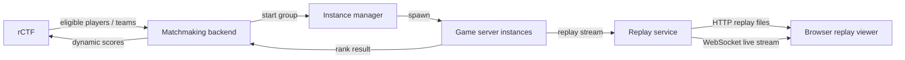
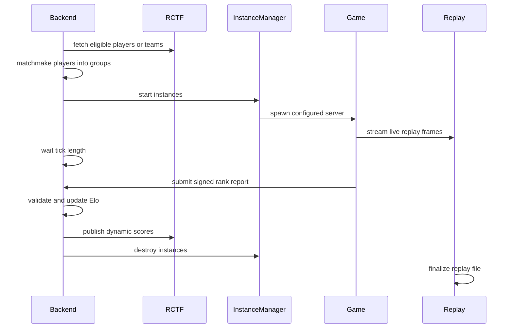

# Matchmaking Backend And Live Replay Plan

This is a planning document only. It sketches the backend needed to run dynamic rCTF matchmaking rounds, calculate ratings, publish leaderboard scores, and expose both recorded and live replay viewing.

## Goals

- Queue eligible rCTF players into recurring match ticks.
- Start isolated game instances with fixed player groups.
- Collect rank reports from each instance after the tick ends.
- Update internal Elo-style ratings from match results.
- Convert ratings into public leaderboard scores and publish them through rCTF dynamic scoring.
- Preserve match replays and make them viewable in a browser.
- Add a live replay mechanism so spectators/admins can open a browser and watch an active match as a 3D scene.

## rCTF Dynamic Scoring Model

rCTF should be treated as the public scoreboard sink, not the matchmaking engine.

The backend owns queue state, match grouping, instance lifecycle, result validation, rating updates, and score normalization. rCTF owns teams/users, challenge visibility, and leaderboard display. After each completed tick, the backend publishes updated dynamic scores for affected active players or teams.

## High-Level Architecture



## Services

### Matchmaking Backend

Responsibilities:

- Poll or receive eligible players from rCTF.
- Maintain queue membership and player readiness.
- Run the fixed interval tick loop.
- Group players with rating-biased random sampling.
- Ask the instance manager to start matches.
- Track match status until completion or timeout.
- Validate reports from game instances.
- Update ratings and leaderboard scores.
- Publish dynamic scores to rCTF.
- Store match metadata and result history.

Recommended implementation:

- Rust service if we want shared types with the game server.
- PostgreSQL for durable queue, ratings, matches, and result state.
- Redis optional for locks, live status, and pub/sub, but not required for the first version.

### Instance Manager

Responsibilities:

- Start game server processes or containers for each group.
- Inject match config, player tokens, seed, map, duration, and replay stream target.
- Provide connection details to players through the backend.
- Enforce max lifetime and cleanup.
- Report process failures.

Initial implementation can be one host, one process per match, generated port allocation, per-instance working directories, and forced cleanup after timeout.

### Game Instance

Responsibilities:

- Accept only assigned player tokens for that match.
- Run the game for the configured tick length.
- Emit replay frames/events during the match.
- Submit a signed rank report at the end.
- Include anti-cheat flags and validation metadata in the report.

The game instance should not decide public score. It should only report match facts.

### Replay Service

Responsibilities:

- Receive live replay frames/events from game instances.
- Persist completed replay files.
- Broadcast active replay streams to browser viewers.
- Serve recorded replay metadata and assets.
- Enforce spectator permissions and optional delay.

This can start embedded in the matchmaking backend, then split out once traffic or ownership gets larger.

## Tick Flow



## Matchmaking

Config:

```yaml
matchmaking:
  players_per_instance: 4
  tick_length_seconds: 300
  min_players_to_start: 4
  max_queue_wait_seconds: 600

  rating:
    initial: 1500
    k: 32

  leaderboard:
    min_score: 1
    max_score: 500

  sampling:
    nearby_band: 200
    temperature: 400
    weights:
      nearby: 0.70
      lower: 0.15
      higher: 0.15
```

Algorithm:

1. Pull all eligible queued players.
2. Shuffle the unassigned set.
3. Pick a random seed player.
4. Fill the group by weighted sampling near the seed rating.
5. Remove chosen players without replacement.
6. Leave leftovers queued for the next tick.

Rating buckets:

- `nearby`: `abs(player.rating - seed.rating) <= nearby_band`
- `lower`: `player.rating < seed.rating - nearby_band`
- `higher`: `player.rating > seed.rating + nearby_band`

Weight:

```text
weight(seed, player) = exp(-abs(seed.rating - player.rating) / temperature)
```

This gives mostly fair matches while keeping enough randomness that players cannot perfectly predict match composition.

## Elo Updates

Each match result is treated as pairwise comparisons.

```text
delta = average(actual(player, opponent) - expected(player, opponent))
rating += k * delta

expected(a, b) = 1 / (1 + 10 ^ ((rating_b - rating_a) / 400))

rank(a) < rank(b) => actual = 1.0
rank(a) > rank(b) => actual = 0.0
same rank        => actual = 0.5
```

Result validation should reject or quarantine reports with unknown match ids, wrong instance signatures, unknown players, missing assigned players, duplicates, impossible rank values, duration outside tolerance, or severe anti-cheat kick/ban states that change eligibility.

## Leaderboard Score

Public score should be normalized from current rating into the rCTF score range.

```text
normalized = (rating - min_rating) / (max_rating - min_rating)
score = round(min_score + normalized * (max_score - min_score))
```

If `min_rating == max_rating`, assign everyone the midpoint of the score range at launch.

## Data Model

### players

```text
id
rctf_team_id
display_name
rating
leaderboard_score
eligibility_status
created_at
updated_at
```

### queue_entries

```text
player_id
queued_at
last_seen_at
status
```

### matches

```text
id
tick_id
status
seed
map_id
started_at
ended_at
instance_id
replay_session_id
failure_reason
```

### match_players

```text
match_id
player_id
slot
rating_before
rating_after
rank
score
anti_cheat_status
```

### rating_events

```text
id
match_id
player_id
rating_before
rating_after
delta
reason
created_at
```

### score_publications

```text
id
tick_id
rctf_challenge_id
published_at
status
response_code
response_body
```

### replay_sessions

```text
id
match_id
instance_id
status
started_at
ended_at
format_version
recording_uri
live_stream_key
visibility
spectator_delay_ms
```

## Replay Plan

Yes, we can improve replays and add a live browser replay. The cleanest path is to make offline replay and live replay use the same stream format.

Current direction:

- Game server emits replay snapshots/events.
- Offline replay stores those frames into a replay file.
- Browser viewer reads the file and reconstructs a 3D scene.

Improved direction:

- Game server emits one canonical replay stream.
- Replay service can both persist and broadcast that stream.
- Browser viewer consumes either a saved file or a live WebSocket feed.
- The same renderer, entity interpolation, camera modes, and assets work for both modes.

## Replay Stream Format

Use a versioned envelope around compact binary or JSON payloads.

```text
ReplayEnvelope {
  version
  session_id
  match_id
  sequence
  server_time_ms
  kind
  payload
}
```

Frame kinds:

- `hello`: stream metadata, map id, assets, tick rate, protocol version
- `snapshot`: authoritative world snapshot
- `delta`: changes since previous snapshot
- `event`: shots, hits, kills, respawns, anti-cheat probes, objective events
- `leaderboard`: current match leaderboard
- `chat`: optional system/player messages if supported
- `end`: final ranks and replay checksum

For the first live version, full snapshots at a fixed rate are simpler and robust. Deltas can come later if bandwidth becomes a problem.

## Live Replay Browser Viewer

Routes:

```text
GET /replays/:session_id
GET /live/:session_id
GET /api/replays/:session_id
GET /api/live
WS  /ws/live/:session_id
```

Viewer features:

- 3D scene rendering in browser.
- live/pause toggle
- scrubber for buffered live history
- player follow camera
- free camera
- top-down tactical camera
- current leaderboard overlay
- kill feed or event log
- anti-cheat event markers for admins
- replay speed controls for recorded replays

Live playback should keep a client-side buffer, probably 1-3 seconds for admin viewing and 10-30 seconds for public viewing. A delay matters because public live spectating can leak positions and undermine fog of war.

## Live Replay Transport

Recommended first version:

- Game server sends replay envelopes to the replay service over local TCP, HTTP streaming, or WebSocket.
- Replay service broadcasts envelopes to browsers over WebSocket.
- Replay service also writes the same envelopes to an append-only replay file.

WebSocket is the best first transport because browser support is easy, bidirectional control messages are available later, and it fits ongoing frame delivery well.

## Replay Storage

Use an append-only file per match:

```text
replays/
  2026-06-06/
    match_<match_id>.mrpl
```

The `.mrpl` format can be a magic header, format version, metadata block, compressed sequence of replay envelopes, and final checksum. Use zstd for archived files, with no compression or light per-message compression for live transport.

## Live Replay Security

Controls:

- private admin-only live streams by default
- optional public streams with delay
- per-session viewer token
- no direct game-server access from browser
- replay service strips hidden/debug-only data for public viewers
- admin viewers can see anti-cheat probes and hidden fake targets
- public viewers should not see fake targets unless reviewing a completed match

The replay stream may contain full authoritative state for review, but public live viewers should receive a filtered or delayed stream. Even with delay, exposing hidden positions during a live round can create out-of-band cheating paths.

## Anti-Cheat And Replay

Replay should help debug and tune anti-cheat.

Record:

- fake target spawn/despawn events
- fake target backing real target id
- player aim angle before/during/after probes
- reaction-time measurements
- target visibility state
- occlusion/fog state used by server
- kick/quarantine decisions
- normal target heuristic scores

Admin replay mode can show these overlays. Public replay mode should hide or simplify them.

## Backend APIs

Queue:

```text
POST /api/queue/join
POST /api/queue/leave
GET  /api/queue/status
```

Matches:

```text
GET /api/matches/current
GET /api/matches/:id
POST /api/instances/:id/report
```

Replays:

```text
GET /api/replays
GET /api/replays/:session_id
GET /api/replays/:session_id/download
GET /api/live
WS  /ws/live/:session_id
```

Admin:

```text
GET  /admin/ticks
GET  /admin/matches
GET  /admin/instances
POST /admin/tick/run
POST /admin/matches/:id/quarantine
POST /admin/scores/publish
```

## Instance Report Shape

```json
{
  "match_id": "match_123",
  "instance_id": "instance_456",
  "started_at": "2026-06-06T18:00:00Z",
  "ended_at": "2026-06-06T18:05:00Z",
  "duration_ms": 300000,
  "players": [
    {
      "player_id": "team_1",
      "rank": 1,
      "score": 42,
      "kills": 12,
      "deaths": 4,
      "anti_cheat_status": "clean"
    }
  ],
  "replay_session_id": "replay_789",
  "anti_cheat_summary": {
    "kicked_players": [],
    "flagged_players": []
  },
  "signature": "..."
}
```

## Failure Handling

- If the game never starts, return players to queue.
- If the game starts but report is invalid, quarantine match and do not update ratings.
- If score publishing fails, keep rating update committed and retry publication.
- If replay recording fails but result is valid, keep the result and mark replay unavailable.
- If anti-cheat kicks a player, include them in the rank report with a disqualified status.

## Observability

Metrics:

- queued players
- matches started/completed/failed
- instance startup time
- report validation failures
- rating delta distribution
- rCTF publish latency/failures
- replay stream bytes/sec
- live viewer count
- WebSocket disconnects

Logs should always include `tick_id`, `match_id`, `instance_id`, `replay_session_id`, and `player_id` when relevant.

## Implementation Phases

### Phase 0: Decisions

- Choose backend crate/service location.
- Decide whether players map to rCTF users or teams.
- Confirm score range and tick length.
- Decide public live replay delay.
- Decide whether replay service starts embedded in backend or separate.

### Phase 1: Backend Skeleton

- Add config loading.
- Add database migrations.
- Add player/rating/queue models.
- Add rCTF dynamic score client.
- Add basic admin/status endpoints.

### Phase 2: Queue And Matchmaker

- Implement queue join/leave/status.
- Implement rating-biased match sampling.
- Add deterministic tests for grouping properties.
- Store tick and match records.

### Phase 3: Instance Lifecycle

- Add process/container instance manager.
- Generate per-match player tokens.
- Start configured game server instances.
- Track instance health and timeout cleanup.
- Return connection info to queued players.

### Phase 4: Results And Scores

- Add signed instance result reports.
- Validate reports.
- Implement pairwise Elo updates.
- Normalize public leaderboard scores.
- Publish dynamic scores to rCTF with retry.
- Store rating events and score publication attempts.

### Phase 5: Replay Format Cleanup

- Define canonical replay envelope.
- Version the replay stream.
- Make offline replay files append-only and checksummed.
- Ensure the current spectator viewer can load the new format.
- Add replay metadata endpoint.

### Phase 6: Live Replay

- Add replay ingest from game server to replay service.
- Broadcast replay envelopes over WebSocket.
- Add browser live route.
- Add buffered playback and camera controls.
- Add admin overlays for anti-cheat events.
- Add public spectator delay and filtering.

### Phase 7: Hardening

- Add auth for admin and live replay routes.
- Add load tests for tick scheduling and replay fanout.
- Add crash recovery for in-progress ticks.
- Add replay retention policy.
- Add operational dashboards.

## Open Questions

- Is the rCTF participant identity team-based or user-based for this challenge?
- Should players opt into queue manually, or does eligibility mean automatically queued?
- Do we want one challenge score per team, or separate score channels for qualifiers/finals?
- How much spectator delay is acceptable for public live viewing?
- Should public replay hide all anti-cheat probes permanently, or only during live matches?
- What is the maximum expected concurrent live viewer count?
- Should replay storage be local disk for the event, or object storage from the start?

## Suggested First Milestone

Build the smallest vertical slice:

1. Backend reads a static eligible player list.
2. Matchmaker forms groups.
3. Instance manager starts local game server processes.
4. Game server emits a signed final report.
5. Backend updates ratings.
6. Backend writes normalized scores to a dry-run rCTF publisher log.
7. Game server writes a replay file.
8. Browser viewer can open that replay file.

After that works, add live WebSocket replay and real rCTF score publication.
