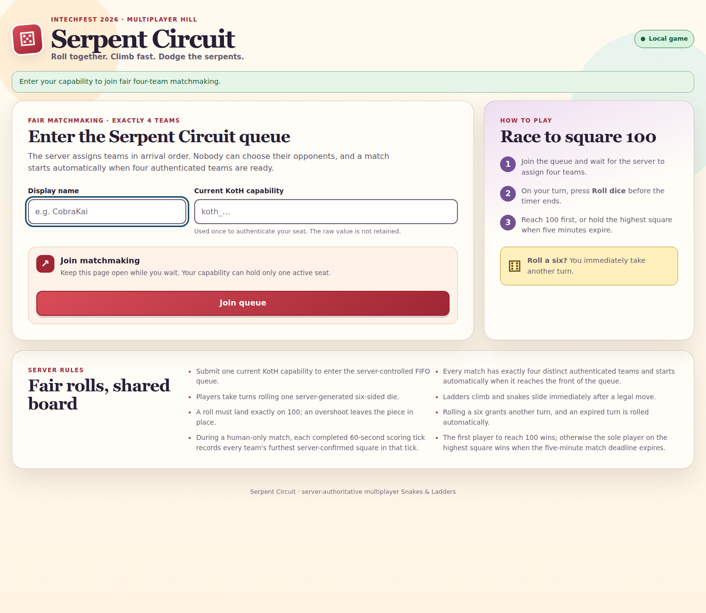

# Serpent Circuit solution

## Verification record

- Status: `draft`.
- Candidate source: uncommitted working tree based on
  `db0325085cc6b5d10b65cc2eac145c241a62a415`; freeze only after the exact commit and hidden
  staging target pass.
- Challenge type and delivery: shared `KingOfTheHill`, direct browser/API service, managed
  Leaderboard reporting, no handout and no gateway.
- Service image: local amd64 image ID
  `sha256:e2b829fcb94669dee2b6fe1adc9ce875e768049edae740727d2edc091549eb5c`.
- Backend and target: hardened local Docker (`nobody`, read-only root filesystem,
  `cap-drop ALL`, no-new-privileges, 128 MiB), `http://127.0.0.1:35041`.
- Verification time and reviewer: `2026-09-02T00:34:33Z`; Codex.
- Solver result: `Solver 1 won after 79 rolls; Solver 1=100, Solver 2=93, Solver 3=61,
  Solver 4=71; score=recorded`.
- Playtest: pending a fresh player-equivalent four-team matchmaking run.

## Summary

Serpent Circuit is a server-authoritative four-team Snakes & Ladders match. A team submits its
current KotH capability once. The server places that team in a FIFO queue, prevents the same
capability from holding two active seats, and assigns exactly four distinct teams to each
match. Players cannot create private rooms, choose opponents, add NPCs, or start a match.

Only one match runs at a time. A full later group waits while the current group plays, then
starts automatically. Reaching square 100 wins immediately. If nobody reaches 100 within
five minutes, the sole player on the highest square wins; a tied highest square has no match
winner. Every completed 60-second scoring tick reports each team's furthest confirmed square
as the native `board-progress` ratio.

## Player inputs

- The issued Serpent Circuit service URL.
- One current KotH capability for the player's team.
- A display name.
- No room code, opponent identity, download, flag, reporter credential, organizer endpoint,
  or source file is delivered.

## Walkthrough

### 1. Read the public contract

- Observation: `GET /api/rules` publishes protocol version 5, the original 100-square board,
  fourteen transitions, four-team limit, 30-second turn timer, five-minute match timer, and
  the exact-finish and extra-turn rules.
- Action: open the browser UI or inspect the same JSON route.
- Result: the player knows the complete board and ranked-match behavior before joining.

### 2. Enter matchmaking

- Action: submit a display name and current capability to `POST /api/matchmaking`.
- Confirmation: the response contains an opaque player token and the server-assigned match
  state. It contains no selectable room code. The browser clears the raw capability and
  stores only the player token for reconnection.
- Capability gained: control of one authenticated piece in one waiting or active match.

The client polls `POST /api/matchmaking/state` with the player token. Waiting players must
keep the page open; an abandoned waiting seat expires after 60 seconds so one closed browser
cannot permanently block three other teams.

### 3. Wait for automatic assignment and start

- Observation: waiting state shows the assigned roster count and how many complete matches
  are ahead.
- Confirmation: when four teams fill the oldest group and no earlier match is active, the
  state changes from `waiting` to `playing` without a host or start request.
- Result: the server publishes the first turn deadline and fixed match deadline.

### 4. Take authoritative turns

- Action: the current player sends its private player token and a fresh action ID to
  `POST /api/matchmaking/roll`.
- Confirmation: all clients see the same server-generated die, movement, transition, next
  player, turn timer, match timer, and board positions.
- Rules: an overshoot stays in place, one snake or ladder applies after movement, a six keeps
  the turn, and the server rolls an expired turn automatically.

### 5. Finish or reach the deadline

- Exact finish: a legal roll onto square 100 immediately ends the match with that player as
  winner.
- Deadline: at exactly five minutes, the server compares current positions. One unique
  highest position wins; an exact top tie returns no winner.
- Queue transition: finishing releases all four capability seats and starts the oldest full
  waiting group automatically.
- Scoring: waiting and finished matches emit no later progress. A completed active tick keeps
  one furthest-position row per capability hash.

## Why it works

The raw capability crosses the rsctf authentication boundary only during matchmaking. The
service retains its SHA-256 hash, lifecycle identity, opaque player token, and authoritative
game state. The queue lookup and one-seat index run under the same lock, so concurrent retries
return the existing seat instead of duplicating a team.

The browser never supplies a room, opponent, roll, position, winner, or score. FIFO grouping,
the one-active-match rule, auto-start, turn deadlines, match deadline, and highest-position
settlement all run in the authoritative process. A modified client therefore cannot arrange
a favorable private group or hold the active slot indefinitely.

Action IDs make a retried roll return its first result. Capability lifecycle changes, roster
revocation, stale waiting seats, bounded rooms and seats, request limits, and the 1,000-turn
safety cap bound shared state. The managed reporter reads the same locked state, emits bounded
native ratios, and never reports raw capabilities or platform points.

| Before | Player-visible clue | Action | Confirmation | Capability gained | Shortcut that fails |
| --- | --- | --- | --- | --- | --- |
| Service URL and capability | Matchmaking form and `/api/rules` | Submit one capability | Opaque player token and assigned group | Control of one piece | Private room or duplicate team seat |
| Waiting group | Roster count and queue-ahead count | Keep polling | Automatic `playing` state at four teams | Timed match seat | Manual start, NPC, chosen opponent, stale abandoned seat |
| Current turn | Roll button and timers | Request one roll | Server move and next turn | Updated position and tick evidence | Client die, position, winner, or replayed roll |
| Active match | Five-minute countdown | Continue legal turns | Exact finish or deadline result | Final match outcome | Extending the deadline or blocking the next group |

## Solver

[`solve.py`](solve.py) is a small protocol rehearsal. On an isolated target, it submits four
distinct capabilities, keeps every assigned seat alive while waiting, follows the current
player ID, and requests legal rolls until the server confirms a unique winner.

```sh
python3 solution/solve.py \
  --url http://127.0.0.1:PORT \
  --capability koth_local_player_00001 \
  --capability koth_local_player_00002 \
  --capability koth_local_player_00003 \
  --capability koth_local_player_00004
```

The solver does not predict or control the die. Run it on a quiet local or hidden staging
target so unrelated queue arrivals do not split the four supplied capabilities across groups.

## Evidence

Focused verification commands for this revision:

```sh
cd events/warmup/challenges/Koth/PPC/serpent-circuit/src
python3 -m unittest -v test_game.py test_capability_auth.py test_reporter.py
node --test test_ui.mjs test_clock.mjs

cd ../checker
python3 -m unittest -v test_run.py
```

The source suite passed 75 Python tests and 9 Node tests. The checker suite passed 14 tests.
The Docker build reran all 75 Python tests (with its expected Node-only clock-test skip), the
container reached `healthy`, and the exact four-capability solver command above completed a
server-visible match through only public routes.

A fixed-rate local load held 100 matchmaking-state polls per second for 15 seconds against
one active four-team match: 1,505 HTTP requests, zero failed checks, zero failed requests,
14.24 ms p95, and 30.88 ms maximum response time. Every response retained `playing` state
and an exact four-player roster.



The screenshot is a genuine 1440×1250 capture of the current local-development service. It
shows the exact-four-team FIFO matchmaking copy, single **Join queue** action, five-minute
deadline rule, and absence of private-room, opponent-selection, NPC, and manual-start
controls. It was captured at `2026-09-02T00:28:18Z`; no capability or player token is visible.
The 322,557-byte PNG has SHA-256
`5c0d4c25386ab5865b494b204820d703e41b1b9670268bfcf6b6f4f44a58ef2a`.

```sh
chromium --headless --no-sandbox --disable-gpu --hide-scrollbars \
  --window-size=1440,1250 --virtual-time-budget=2500 \
  --user-data-dir=/tmp/serpent-circuit-v5-screenshot \
  --screenshot=solution/assets/serpent-circuit-board.png \
  http://127.0.0.1:35039
```

The temporary browser profile was removed after the screenshot. Hidden-staging evidence and
the exact committed identity remain pending while this record is `draft`.

## Notes

- Local development requires `SERPENT_LOCAL_DEV=1`; syntactically valid local capabilities
  are accepted but only their hashes are retained.
- A waiting seat expires after 60 seconds without its own state poll. Waiting rooms otherwise
  expire after 30 minutes, active state is bounded by the five-minute match timer, and
  finished matches expire after ten minutes.
- The checker remains read-only. Its deterministic non-roster capability probe cannot
  allocate matchmaking state.
- A pure Snakes & Ladders result is luck-driven. Tick scoring rewards relative furthest
  progress throughout the match; the five-minute winner is a player-facing match result, not
  a direct platform-points submission.
